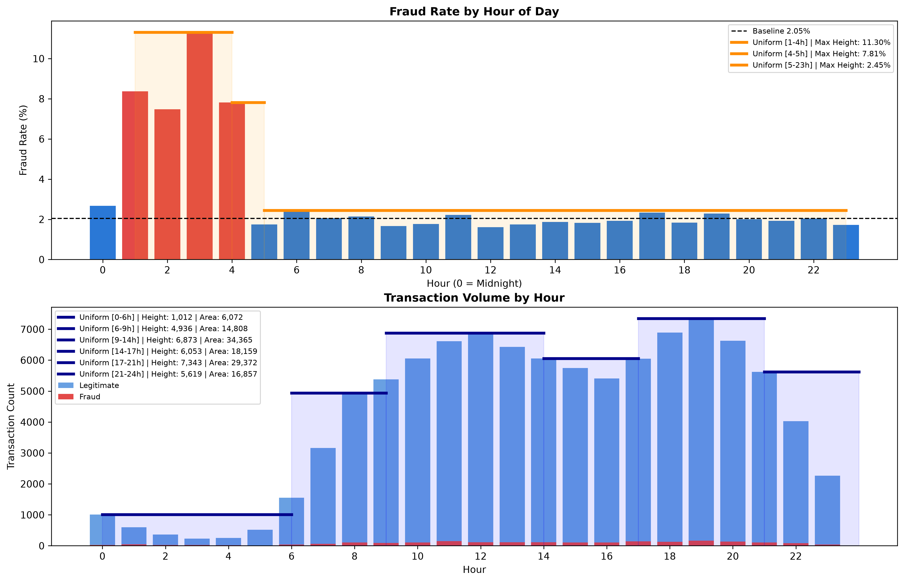

Sources of information:

Data Generation:
- https://www.kaggle.com/datasets/mohankrishnathalla/credit-card-fraud-detection-dataset-2026 (used for finding distribution of transactions each hour)
- The simulated data is for a one year period

TODOs:
- Add better documentation for random functions
- Adding tests for the functions 

Notes from Jess:
 - I use the pixi enviornemnt manager but feel free to use whatever, just make a comment if you use a specific version of a package or anything
 - [AMS-553-Simulation-and-Modeling/random_variate_generator.py](AMS-553-Simulation-and-Modeling/random_variate_generator.py) has a bunch of random variable generation 